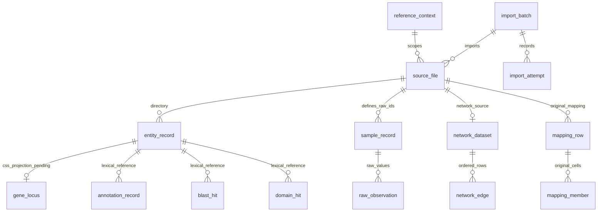

# TeaGeneQA V1 实际 Schema 与数据边界

实际迁移位于 `migrations/versions/58a1592310ad_initial_versioned_source_evidence_schema.py`，所有表限定在 `teageneqa` Schema，Alembic 的版本表也在该 Schema。应用固定 `search_path=public` 并对业务表显式加 Schema，避免同名数据库角色导致自动迁移误识别。

## 已实现的 17 张业务表

| 表 | 核心字段 | 键与关联 |
| --- | --- | --- |
| reference_context | key、label、metadata_raw、semantic_status | id 主键，key 唯一；表示显式声明的来源快照，不伪造生物学版本 |
| import_batch | context_id、manifest_sha256、status、summary、时间 | id 主键，FK 到上下文；每次重跑均记录运行历史 |
| import_attempt | batch_id、filename、status、details | id 主键，记录 skipped/failed/imported 与异常定位 |
| source_file | context_id、batch_id、kind、dataset_code、filename、sha256、encoding、headers、row_count、source_metadata | id 主键；UNIQUE(context_id,kind,dataset_code)；同来源槽位不同内容报冲突 |
| entity_record | source_entity_id、name_raw、entity_kind、semantic_status、原始字段及来源 | PK(source_file_id,record_no)；上下文内 source_entity_id/name_raw 分别唯一 |
| gene_locus | context_id、css_id、source_entity_id、semantic_status | PK(context_id,css_id)；仅标准 CSS 形式投影；FK 到同上下文来源实体，语义 pending |
| annotation_record | source_entity_id、anno_id、anno_type、anno_name、raw_fields | 来源行复合主键；原始 GO/KO 注释，不制造 evidence code |
| blast_hit | source_entity_id、accession、raw_fields | 来源行主键；sLen/sStart/sEnd/mStart/mLen/mEnd/mIdentity/sIdentity/pValue 全部保留在 raw_fields |
| domain_hit | source_entity_id、accession、annotation_type、method_raw、raw_fields | 来源行主键；保留 iType/mothod/区间/分值和多方法业务重复 |
| factor_assignment | source_entity_id、factor_type、family_raw、raw_fields | 来源行主键；原样保留 TF/TR/ARR-B/p15，不统一改成 TF |
| sample_record | source_file_id、sample_id_raw、metadata_raw、semantic_status | PK(source_file_id,sample_id_raw)，不跨来源合并同名样本 |
| raw_observation | source_entity_id、sample_id_raw、value_raw、value_numeric、measurement_kind、raw_fields | 来源行主键；FK 同文件 sample；样本/单位元数据未决，基因与非 CSS 测量分层 |
| gene_sequence | source_entity_id、六类 TEXT 序列、来源行非序列字段 | 来源行主键；普通档案只计数，按类型查询只读取指定序列列 |
| network_dataset | source_file_id、code_raw、metadata_raw、semantic_status | source_file_id 主键；10 个原始数据集独立保留 |
| network_edge | tag1_raw、tag2_raw、person_r_raw、person_p_raw、raw_fields | 来源行主键；两个端点均引用同上下文目录；保留有序边与原值 |
| mapping_row | candidate_css_id、transform_rule、semantic_status、raw_fields | 来源行主键；保留 10 个材料/版本列原字符串 |
| mapping_member | source_file_id、record_no、namespace_raw、identifier_raw | PK(source_file_id,record_no,namespace_raw)；每个非缺失单元格建索引，无跨材料身份外键 |

除 gene_locus 和索引辅助表外，证据表共享：`source_file_id`、`record_no`、`context_id`、`source_row_id`、`raw_fields JSONB`。来源行 ID 在同文件唯一，不能当作跨表基因键。序列列独立存 TEXT，不在 JSONB 重复存储；来源追溯接口按需重建完整原始字段。

相较第一阶段的候选设计，V1 将通用 source_record 的字段嵌入各证据表，减少七百万行中间表与二次连接；未实现未经确认的 biological resolved_gene_id 层。当前实体引用外键只验证“同一显式来源上下文中目录记录存在”，**不声明转录本/蛋白层级、跨版本正交或生物学身份已确认**。`lexical_status=matched` 与 `semantic_status=pending` 同时返回。

## 关系与查询索引

核心索引：每个实体证据表 `(context_id,source_entity_id)`；观测额外 `(context_id,source_entity_id,sample_id_raw)`；注释 anno_id、BLAST/domain accession、TF family；网络 `(context_id,tag1_raw,source_file_id)` 与 tag2 对应索引；映射 `(namespace_raw,identifier_raw,source_file_id)`。PK/UNIQUE 自动提供 B-tree 索引。本阶段未创建向量索引或全文索引，未假设其性能收益。

列表分页按 `(source_file_id,record_no)` 稳定排序，不把多条来源证据合并成一条。综合档案分表查询，避免 BLAST×domain×GO×样本的连乘。相同 CSS 位点在不同上下文出现时返回 409；不会选择“最新”上下文替用户做决定。

## 保留的未决语义

- `Genome=3`、CSS/SCZV2、数字后缀及物种/组装/注释版本仍待来源字典。
- 13 个非 CSS 实体保存为 non_css_unresolved，不进入 gene_locus；其数值保持 non_css_unresolved_measurement。
- sampleID 保持文本，单位/组织/处理/时点/重复/归一化为空；两个编号块不自动配对。
- PFAM/IPR 的 eValue 和 BLAST pValue 不重命名为已确认统计量；所有原始字符串，包括零、NA、前导空格和方法拼写都保留。
- mapping_member 是原映射行单元格的索引，不认定任意两种材料标识符相互等价，不做传递闭包。
- candidate_css_id 仅在清单显式声明 mapping_anchor_namespace 且词法基础编号命中目录时产生；未声明则保持 NULL，不因 CSV 列相同就猜测参考归属。

当前记录溯源可以恢复字段值、文件哈希、批次与 CSV 数据记录号，不承诺恢复原文件的字节级引号/换行写法；字节级原件仍由未修改的 data/raw 和 SHA-256 证明。
